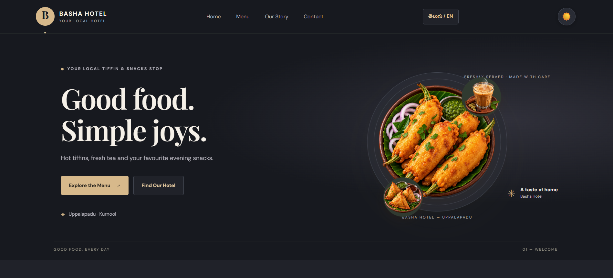
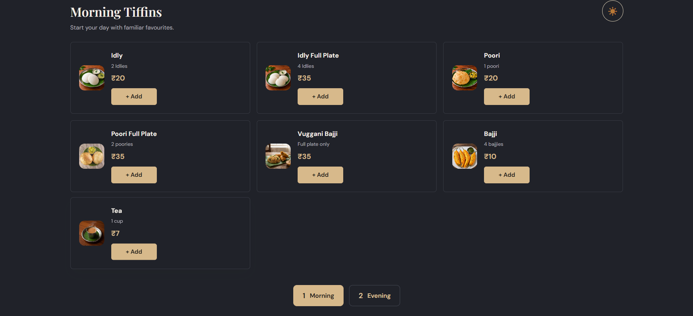
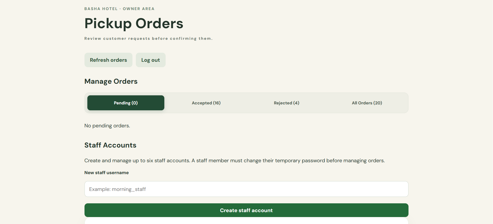
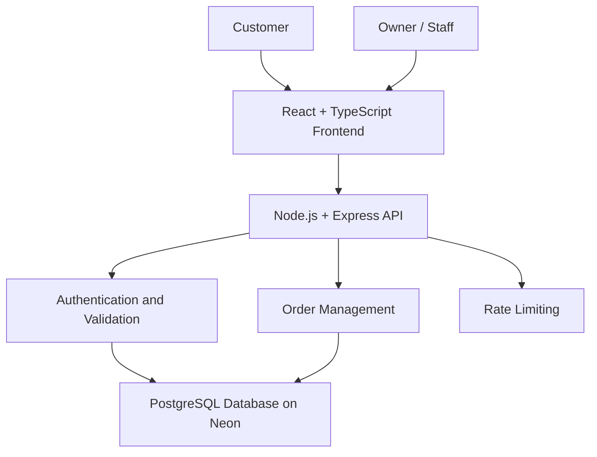

# 🏨 Basha Hotel — Full-Stack Pickup Ordering Platform

<p align="center">
  A modern, bilingual website for a local hotel in Uppalapadu, Kurnool, Andhra Pradesh.
  <br />
  Browse the menu, place pickup orders, and manage orders through a secure owner dashboard.
</p>

<p align="center">
  <a href="https://basha-hotel.onrender.com/"><strong>🌐 Live Website</strong></a>
  &nbsp;•&nbsp;
  <a href="https://github.com/hussain2004/basha-hotel"><strong>💻 GitHub Repository</strong></a>
</p>

<p align="center">
  
  
  
  
  
  
</p>

---

## 📌 Project Overview

Basha Hotel is a full-stack web application built to help a local hotel present its menu online and manage customer pickup orders.

The application provides a bilingual customer experience in English and Telugu, a food menu with prices, a shopping cart, order tracking, and an owner dashboard for managing orders and staff accounts.

**Project goals:**
- Make the hotel menu accessible online.
- Allow customers to prepare and submit pickup orders.
- Help the owner review, accept, and reject orders.
- Provide a simple interface suitable for mobile and desktop users.
- Support the hotel's day-to-day operations with a practical digital solution.

## 📸 Screenshots

### 🏠 Homepage

The landing page introduces Basha Hotel, highlights the local food experience, and provides navigation to the menu and hotel information.



### 🍽️ Menu and Pricing

Customers can browse available tiffins and snacks, view prices, switch between morning and evening menus, and add items to their cart.



### 📋 Owner Dashboard

The owner dashboard provides order-status views and staff-account management tools.



---

## ✨ Features

### 👨‍🍳 Customer Experience
- **Bilingual interface:** English and Telugu support.
- **Digital menu:** Browse food items and prices.
- **Shopping cart:** Select items and quantities before checkout.
- **Pickup ordering:** Submit customer details and pickup notes.
- **Order tracking:** Check order status using the order-tracking feature.
- **Responsive interface:** Designed for mobile and desktop use.

### 🔐 Owner and Staff Management
- Authenticated owner and staff access.
- Protected order-management API endpoints.
- View incoming customer pickup orders.
- Accept or reject pending orders.
- Update order statuses for customer tracking.
- Manage staff accounts through the owner dashboard.
- Session-based authentication with production cookie-security settings.

### 🛡️ Security and Reliability
- Server-side validation for order submissions.
- PostgreSQL-backed persistent application data.
- Environment variables for sensitive configuration.
- Rate limiting on order submissions to help reduce automated abuse.
- Production deployment using Render and Neon PostgreSQL.

---

## 🧰 Technology Stack

| Layer | Technologies |
|---|---|
| Frontend | React, TypeScript, Vite |
| Backend | Node.js, Express.js |
| Database | PostgreSQL |
| Database hosting | Neon |
| API | REST APIs |
| Authentication | Session-based authentication |
| Security | Express rate limiting, protected routes, secure environment configuration |
| Deployment | Render |
| Version control | Git, GitHub |

---

## 🏗️ Application Architecture



The frontend communicates with the Express backend through API endpoints. The backend handles application logic, authentication, validation, and database operations. PostgreSQL stores persistent application data.

---

## 🔄 Order Workflow

1. The customer opens the website and browses the menu.
2. The customer adds items to the cart.
3. The customer submits a pickup order with the required details.
4. The backend validates the submission and stores the order.
5. The owner or an authorized staff member reviews the order.
6. The order is accepted or rejected.
7. The customer can check the order status.

**Current scope:** Pickup ordering only. Online payment and delivery are not currently offered.

---

## 🚀 Live Deployment

- **Website:** https://basha-hotel.onrender.com/
- **Source code:** https://github.com/hussain2004/basha-hotel
- **Database:** PostgreSQL hosted on Neon
- **Application hosting:** Render

The production application uses environment variables to configure its database connection and security-related settings.

---

## 💻 Run Locally

### Prerequisites

Install the following before running the project:

- Node.js and npm
- Git
- PostgreSQL database or a Neon PostgreSQL database

### 1. Clone the repository

```bash
git clone https://github.com/hussain2004/basha-hotel.git
cd basha-hotel
```

### 2. Install dependencies

```bash
npm install
```

### 3. Configure environment variables

Create a local `.env` file in the project root using the following placeholders:

```env
NODE_ENV=development
DATABASE_URL=your_postgresql_connection_string
SESSION_SECRET=your_long_random_session_secret
OWNER_PASSWORD_HASH=your_bcrypt_password_hash
```

Replace each placeholder with the appropriate local configuration. Do not commit real credentials, password hashes, or secret values to GitHub.

### 4. Start the application

Use the development and startup commands defined in the project's `package.json` and backend configuration. The frontend and backend may need to be started separately, depending on the available scripts.

For production, the deployed backend uses `server/server.postgres.js`.

---

## ☁️ Deployment and Configuration

The production deployment uses:

- **Render** to host the application.
- **Neon** to provide PostgreSQL storage.
- **Environment variables** to store deployment configuration outside the source code.

When deploying your own instance, configure the required environment variables in the hosting provider's dashboard and ensure the database schema is initialized correctly.

---

## 🧠 Engineering Highlights

This project demonstrates practical full-stack development concepts, including:

- Building a responsive React and TypeScript user interface.
- Designing and integrating REST API endpoints.
- Connecting a Node.js backend to PostgreSQL.
- Implementing session-based authentication.
- Protecting owner and staff operations.
- Validating customer order submissions.
- Applying rate limiting to an API endpoint.
- Deploying a full-stack application and maintaining a public GitHub repository.

---

## 🔮 Potential Future Improvements

- Online payment integration.
- Order-ready notifications.
- Improved order analytics and reporting.
- Automated database backups and recovery testing.
- Expanded accessibility and mobile usability testing.

---

## 👨‍💻 Developer

**Shaik Mahaboob Hussain**

B.E. Computer Science and Engineering | 2026 Graduate

- GitHub: https://github.com/hussain2004
- Project repository: https://github.com/hussain2004/basha-hotel
- Live project: https://basha-hotel.onrender.com/

---

<p align="center">
  Built with ❤️ for Basha Hotel, Uppalapadu, Kurnool, Andhra Pradesh.
</p>